# iShareScreen Desktop

## routeOS virtual HMI (development)

This checkout also supports **RVDP 1.0 / 1.1** devices alongside the existing VNC
connections. Choose **routeOS virtual HMI (RVDP)** in Connect To, or enter a
`ws://device-ip:81/rvdp` URL. For the routeOS host simulator, use
`ws://127.0.0.1:8095/rvdp`. The first complete screen must arrive before a session
is saved. Fit, zoom, refresh, reconnect, and the connection library are shared.

Sessions start view-only. Request pointer + keyboard control explicitly when connecting;
the device must grant it. RVDP 1.1 also supports physical keyboard input when the device advertises it
and grants control. Click the display to focus typing; Orbit uses Enter to
calculate, Tab to change pages, and Escape to return to the calculator.
RVDP has no clipboard, audio or Mac shortcuts.
Plain WebSocket is for an isolated development LAN; customer deployments require
authenticated WSS or a secured gateway. `wss://` keeps certificate verification.
URLs containing credentials, query tokens, or fragments are rejected rather than
persisted. Reconnect uses the existing window action with a fresh handshake/full
snapshot. Build both updated Desktop and Liquid Glass executables with
`./packaging/build.ps1 -DistDir dist/orbit`; output is local and not tracked in Git.

The RFB engine is unchanged. RVDP lives in `protocols/rvdp/` with a separate Qt
controller in `frontend/desktop/rvdp.py`. Run `python -m pytest tests/test_rvdp.py`
for protocol and real-window tests; run the full suite before rebuilding binaries.

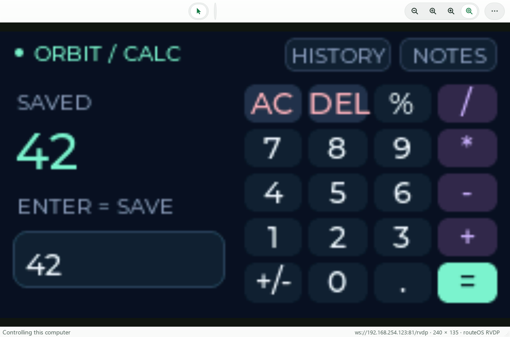

*Physical ESP32 output (240×135), received by the actual native session window;
captured through Qt offscreen on 22 October 2026. Unlike the Mac screenshots below,
this screen is live device-rendered pixels, not a drawn stand-in.*

<p align="center">
  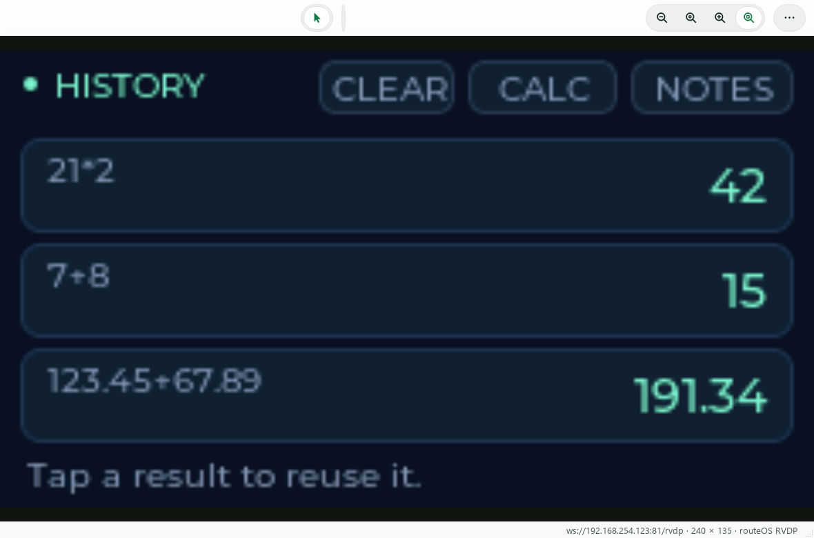
  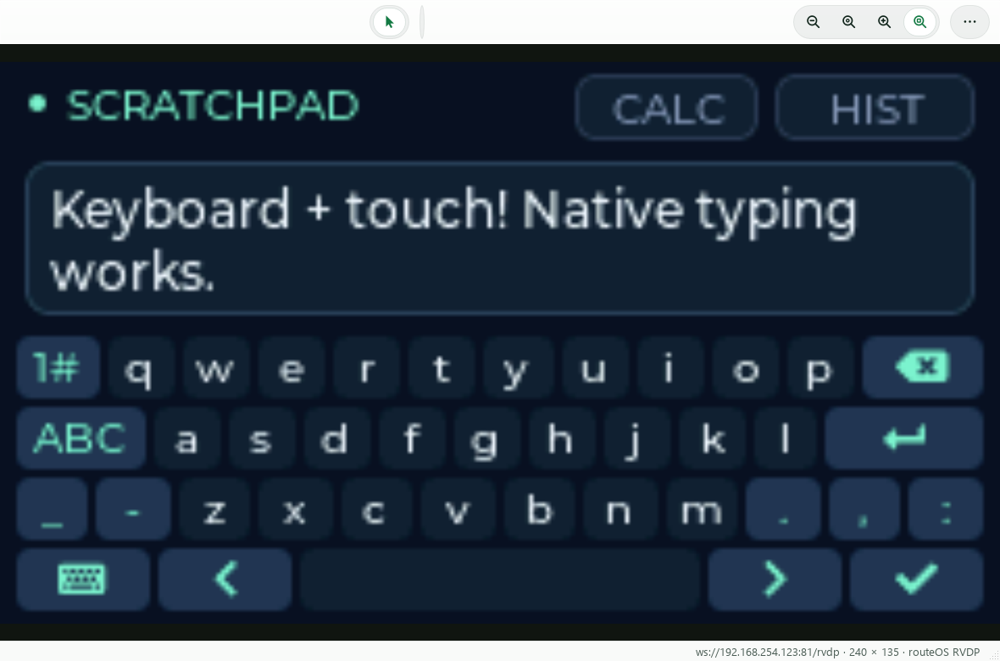
</p>

The Orbit UI includes a 20-button calculator, reusable history, and a scratchpad.
It is a real EEZ Studio LVGL export running on the ESP32. These native window
captures receive live hardware pixels through Qt's offscreen platform.
The firmware, editable EEZ project and protocol specification are in
[routeOS](https://github.com/pointlessduffin-21/routeOS/tree/main/virtual-hmi).

---

A native Windows client for macOS Screen Sharing (Intel and Apple Silicon Macs),
laid out like the Screen Sharing app on a Mac: a library of your computers, small
connect and sign-in dialogs, and a window per remote desktop with a symbol toolbar.
No browser is involved.

<p align="center">
  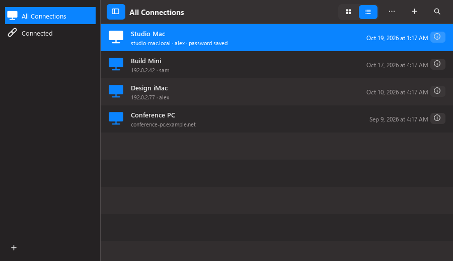
  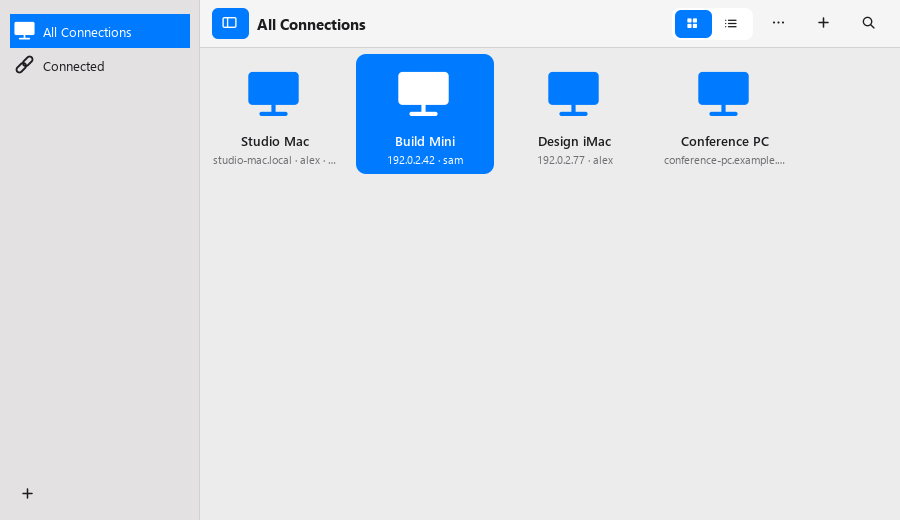
</p>
<p align="center">
  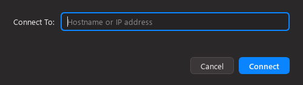
  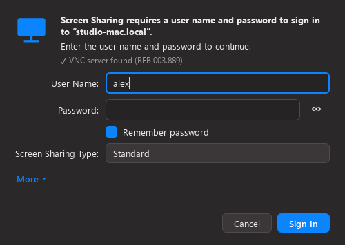
  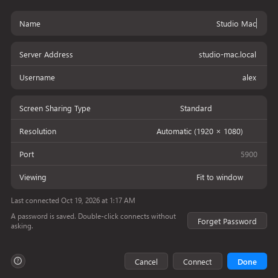
</p>
<p align="center">
  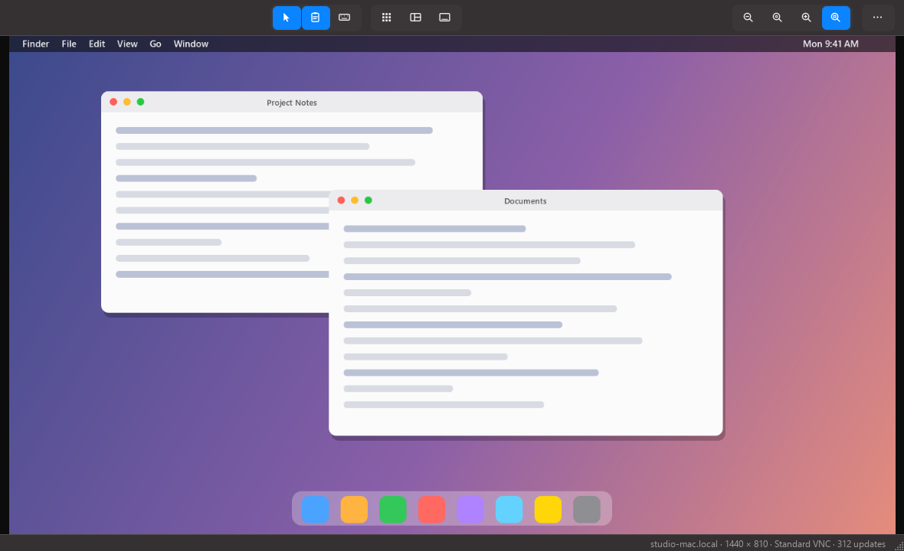
</p>

<sub>Screenshots are drawn by `docs/make_screenshots.py` from the real windows, with
made-up computers and a drawn desktop.</sub>

## Liquid Glass edition

The same app in a second look, built on the
[Liquid Glass design kit](https://github.com/pointlessduffin-21/liquid-glass-design):
a soft sage field, frosted panels, opaque wells for lists and forms, pill buttons and
short fades. The layout and every feature are the same. It ships as its own
executable, **`dist/iShareScreen-LiquidGlass.exe`**, and shares the library and saved
passwords with the standard edition. From source, add `--style glass` (or set
`ISS_STYLE=glass`).

<p align="center">
  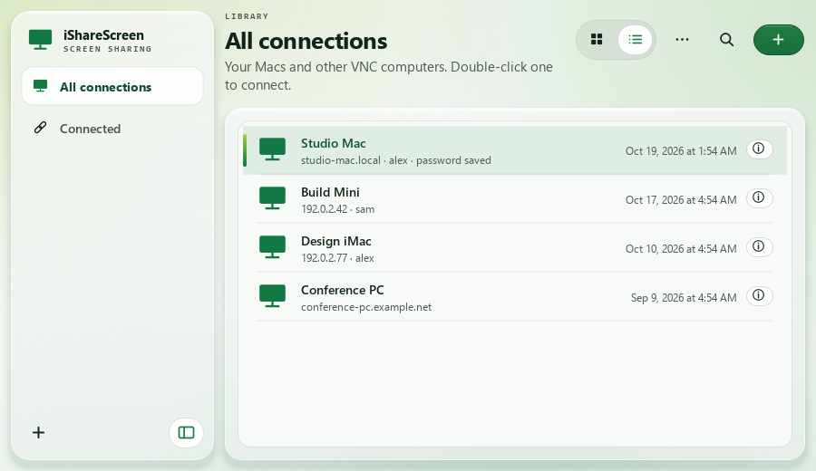
  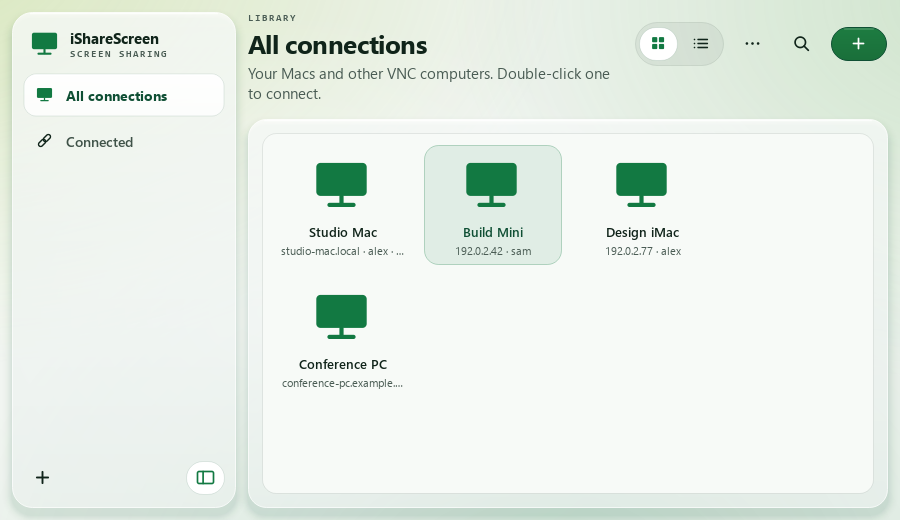
</p>
<p align="center">
  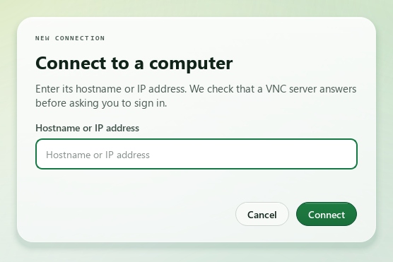
  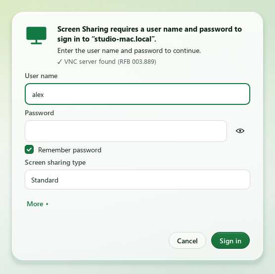
  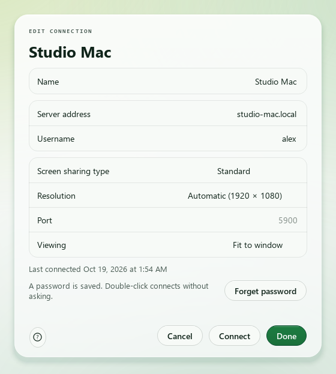
</p>
<p align="center">
  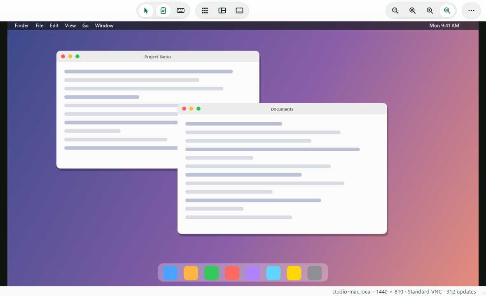
</p>

Qt cannot blur what is behind a window, so the glass is the kit's no-blur variant:
translucent white panels over the painted field. It is light only. Panels turn opaque
when Windows' *Transparency effects* are off (or `ISS_EFFECTS=reduced`), and
`ISS_REDUCE_MOTION=1` keeps the fades to about 120 ms with no stagger. Nothing in
the app moves or scales; motion is opacity and colour only.

## Run it

Build the executable (below) and double-click **`dist/iShareScreen-Desktop.exe`**
(`dist/iShareScreen.exe` is an identical copy). Python is bundled; there is nothing
to install. The `.exe` is not committed to git because of its size (about 95 MB).

On the Mac, turn on **System Settings → General → Sharing → Screen Sharing**. The
Mac must be reachable on TCP 5900, directly or through a VPN such as Tailscale.

### The library

A sidebar (**All Connections**, **Connected**) and a header of symbol buttons: sidebar,
grid/list, ⋯ (sort), ＋ (new connection, `Ctrl+N`) and search (`Ctrl+F`). Each row
shows the name, address, last-connected time and an ⓘ button. Double-click or Enter
connects. **ⓘ**, `Ctrl+E` or the right-click menu opens the **Edit** sheet (name,
server address, username, Screen Sharing Type, port, viewing, with Connect and
Done); the menu also has Rename, Forget saved password and Remove from library
(open sessions to it stay connected).

### Connecting

＋ opens **Connect To:** with one field for a hostname or IP address (`host:port` also
works). The address is checked first, by reading the server's RFB banner and its
offered login types, so you are never asked for credentials for a computer that is
not there. A sign-in dialog then asks only for what that server wants (an account
and password for a Mac; just a password, or nothing, for other VNC servers). It
shows real progress, saves the computer on success, and opens the desktop in its own
window. A wrong password returns to the sign-in dialog with everything else kept.

Every session has its own window, socket and lifecycle, so several Macs can be open
at once; closing one never affects the others.

**Remember password** is off by default. When ticked, the password goes in
**Windows Credential Manager** (never in the library file, and tied to your Windows
account), and double-clicking that computer then connects by itself, still showing
progress and any error. Changing a computer's address, port or username forgets its
saved password so it can never be sent somewhere else, and a Mac that rejects a
saved password makes the app ask for a new one.

### The session window

The toolbar uses symbols (the names are in the tooltips), grouped like macOS:

| Group | Buttons |
|---|---|
| Input | **Control** (turn off to only watch), **Share clipboard**, **Type clipboard** |
| Mac shortcuts | **Launchpad**, **Mission Control**, **Show Desktop** |
| View | **Zoom out**, **Actual size**, **Zoom in**, **Fit to window** |
| **⋯** | Refresh, Full Screen (`Ctrl+Alt+Enter`), Reconnect, Ctrl = Command, Swap Alt/Win, Disconnect |

* Mission Control (Control+Up) and Show Desktop (F11, press again to restore) were
  measured on both an Intel and an Apple Silicon Mac. Launchpad opens through
  Spotlight and only types anything once it has seen Spotlight open, so it does
  nothing on a Mac with another Spotlight shortcut, or on a screen too busy to tell.
* When zoomed in, push the pointer against a window edge to scroll that way.
* **Clipboard:** with Share clipboard on (the default, per session), text copied on
  the Mac is copied locally, and text you copy here goes to the Mac when you switch
  to that session or copy while it is focused. Whatever is on the clipboard when a
  session starts is not sent. Plain text only; sent text is Latin-1 (other characters
  become `?`) and at most 1 MB. **Type clipboard** types the text as keystrokes
  instead, which handles other languages (emoji excepted).
* **Keyboard:** the Windows key acts as Command and Alt as Option on the Mac. Turn on
  **Ctrl = Command** so Ctrl+C, Ctrl+V and Ctrl+Z work as on Windows, and/or
  **Swap Alt/Win** so Alt is Command and the Windows key is Option. Details are in
  [packaging/README.md](packaging/README.md).

The look follows Windows' light or dark setting (`ISS_THEME=light|dark` forces one).
Audio is not implemented yet.

### What it connects to

It speaks ordinary Screen Sharing ("Standard"): Apple's login (security type 30), RFB
framebuffer updates and zlib over TCP 5900. It leaves the Mac's display and
resolution alone. It also works with other VNC servers that offer VNC password or no
authentication (RFB 3.7 and 3.8); servers that require TLS, VeNCrypt, Tight or RA2
are refused with an explanation. That last path is tested against a local fake
server only.

**High Performance** (Apple's UDP video mode) is **planned for a later release**. It
appears in Screen Sharing Type as unavailable. Early engine code is in the
repository but is not part of this release and is hidden unless `ISS_EXPERIMENTAL_HP=1`
is set; see `docs/DESKTOP_REDESIGN_HANDOFF.md` for what testing showed.

## Develop and build

```powershell
python -m venv .venv
.venv/Scripts/python.exe -m pip install -e '.[test]'
.venv/Scripts/python.exe -m isharescreen.frontend.desktop.standard_app
```

The `iss` and `isharescreen` console entry points also open the native app. To run
the tests and build the executable (Windows x64, Python 3.14):

```powershell
./packaging/build.ps1
.venv/Scripts/python.exe packaging/check_exe.py
```

See [packaging/README.md](packaging/README.md) for the build and the executable smoke
check. The test suite (about 290 tests) drives the real windows against local fake
servers (Apple login, VNC password, no authentication, RFB 3.7, refusals) and
against real Macs only through the separate live checks described in the handoff
document. To regenerate the screenshots: `python docs/make_screenshots.py` (add
`--glass` for the Liquid Glass set).

## Legacy protocol research

The repository retains the original High Performance protocol implementation,
browser bridge, capture dissector and protocol notes for development. They are not
part of the native app's normal operation.

## License

AGPL-3.0-or-later. See [LICENSE](LICENSE). Design reference attribution is in
[THIRD_PARTY_NOTICES.md](THIRD_PARTY_NOTICES.md).
